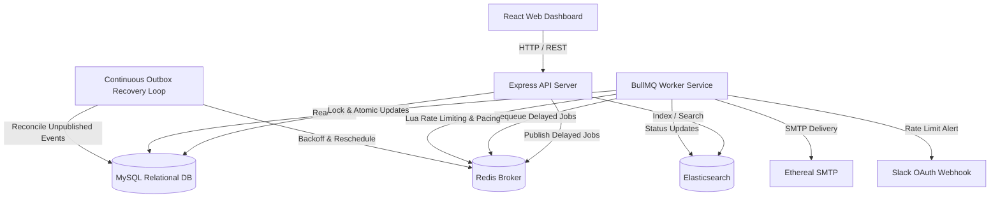

# ReachInbox Full-Stack Architecture Documentation

## 1. System Overview

ReachInbox is a high-reliability, distributed full-stack email job scheduler engineered with Node.js, TypeScript, Express, BullMQ, Redis, MySQL, and Elasticsearch.

## 2. Core Architectural Pillars

### A. Persistent Delayed Scheduling with BullMQ & Redis
- Emails are scheduled as delayed BullMQ jobs where `jobId = emailId`.
- Stable Job IDs ensure idempotency: BullMQ will not duplicate jobs with an identical ID.
- BullMQ stores jobs in Redis sorted sets (`zset`) with execution timestamps as the score.
- **Restart Recovery**: If the API, Worker, or Redis restarts, delayed jobs remain persisted in Redis AOF/RDB storage. Upon worker restart, BullMQ automatically resumes monitoring the delayed set without recreating jobs.

### B. Transactional Outbox Pattern (Strictly Zero Cron)
- When a user schedules an email batch, a MySQL database transaction simultaneously creates:
  1. Campaign record
  2. Staggered Email records with unique SHA-256 idempotency keys
  3. `OutboxEvent` records
- The API publishes jobs to BullMQ and marks `OutboxEvent.publishedAt = now()`.
- If the server or network crashes between the MySQL commit and BullMQ publication, a **continuous bounded outbox reconciliation loop** running in the worker process recovers unpublished events created > 3 seconds ago, using a distributed Redis NX lock (`outbox_recovery_lock`).
- **Why this is NOT a cron job**: It is an event-driven self-healing reconciliation process using exponential backoff and distributed mutex locking, without any cron expressions, node-cron, or OS cron schedulers.

### C. Distributed Rate Limiting & Send Pacing
1. **Atomic Hourly Limiter**:
   - Implemented via a Redis Lua script running `INCR` and `EXPIRE` on fixed UTC hour window keys: `sender_rate:{senderId}:{windowStart}`.
   - Prevents race conditions across any number of parallel worker instances.
2. **Atomic Minimum Send Delay Pacing**:
   - Enforces a minimum interval between SMTP delivery attempts for each sender across all workers using `sender_pacing:{senderId}` in Redis.
3. **Safe Rescheduling on Limit Encounter**:
   - When a sender reaches its hourly limit, remaining jobs are **NEVER dropped and NEVER failed**.
   - The worker calculates the next UTC hour window timestamp, reschedules the job in BullMQ with the required delay, and preserves its stable identity.
   - Updates MySQL status and creates an audit `EmailEvent`.

### D. Deduplicated Slack Rate-Limit Notifications
- When a sender hits its hourly limit, a notification right is claimed in Redis with an atomic `SET NX` key: `slack_alert:{senderId}:{windowKey}` with a 1-hour TTL.
- Only the **first** email encountering the limit in that window triggers a Slack message.
- Subsequent jobs encountering the exhausted quota are rescheduled silently without spamming the user's Slack channel.
- If Slack is disconnected or credentials are missing, worker processing continues uninterrupted.

### E. Idempotency & Ambiguous Delivery Handling
- Before attempting delivery, workers execute an atomic database transition:
  `UPDATE emails SET status = 'PROCESSING', attemptCount = attemptCount + 1 WHERE id = :id AND status IN ('SCHEDULED', 'QUEUED')`.
- If the lock is not acquired, the job is aborted immediately to avoid duplicate send attempts.
- **Ambiguous SMTP Outcomes**: In distributed systems, if an SMTP socket drops or times out after sending the `DATA` command, the remote SMTP server may have already accepted and queued the message. Blindly retrying such emails risks duplicate deliveries to real human recipients. ReachInbox transitions such ambiguous outcomes to `UNKNOWN_RECONCILE` for safe operational review.

### F. Elasticsearch Search Isolation
- All scheduled and sent emails are indexed in Elasticsearch (`reachinbox_emails`).
- Search queries strictly enforce user tenancy (`must: [{ term: { userId } }]`) to ensure total multi-tenant data isolation.
- If Elasticsearch is temporarily unreachable, the search API falls back seamlessly to MySQL queries.
